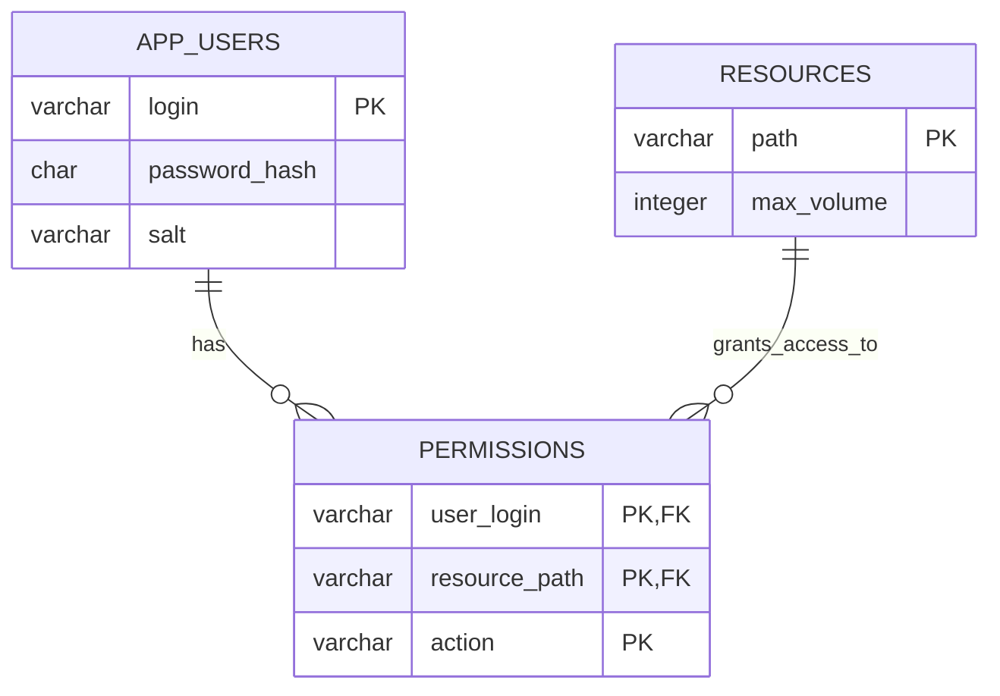

# Лабораторная №6: план хранения данных в H2

## Сущности, атрибуты и связи

- `app_users`: `login` - первичный ключ, `password_hash` - SHA-256 из соли и пароля, `salt` - соль. Пароли открытым текстом не хранятся.
- `resources`: `path` - первичный ключ и путь ресурса, `max_volume` - неотрицательный целый лимит объёма.
- `permissions`: `user_login` и `resource_path` - внешние ключи, `action` - `read`, `write` или `execute`. Все три поля составляют первичный ключ, поэтому дублирование одного права невозможно.

Пользователи и ресурсы связаны отношением многие-ко-многим через `permissions`. Одна строка - одно разрешённое действие. JDBC-репозиторий объединяет действия одного пользователя на одном ресурсе в существующий `Permission.actions`.

Права на предков продолжают наследоваться по сегментам пути в `AccessPolicy`. Отдельную таблицу предков не добавляем: алгоритм бизнес-логики остаётся прежним. Отсутствие записи означает отсутствие разрешения; отдельные запрещающие записи не вводятся.

## Техническая реализация

Встроенная файловая H2 2.5.252, драйвер `org.h2.Driver` из `lib/h2-2.5.252.jar`, подключён вручную. Приложение использует стандартные `java.sql.Connection`, `DriverManager`, `PreparedStatement`, `ResultSet`; ORM, пулы и системы сборки не используются.

Адрес приложения: `jdbc:h2:./data/access;IFEXISTS=TRUE`, локальный пользователь `sa`, пустой пароль. Файл базы - `data/access.mv.db`. Это настройки учебной локальной базы, отдельный сервер не требуется. Для иной базы предусмотрена переменная окружения `KOTLINBAZA_DB_PATH` с файловым путём без расширения; формат CLI не меняется.

`scripts/init-db.sh` выполняет `scripts/init.sql` и затем `scripts/fill.sql` через штатную утилиту H2 `RunScript`. Создаются таблицы, внешние ключи и ограничения, затем прежние 2 пользователя, 7 ресурсов и 3 права. Повторный запуск не дублирует стартовые записи и не перезаписывает изменённые значения. Это начальное заполнение, а не система миграций; восстановление вручную удалённых стартовых записей возможно при повторном запуске.

DDL H2 фиксируется отдельно; инициализация не является единой атомарной миграцией. При ошибке скрипт завершается ненулевым кодом, после устранения причины его можно повторить. Рабочее приложение схему и записи само не создаёт.

База хранится локально и не коммитится; в репозитории хранятся SQL и драйвер для воспроизводимого создания базы. Бэкап: при закрытом приложении скопировать `.mv.db`. Для запуска `java -jar out/app.jar` драйвер добавлен в манифест.

## Компоненты и изменения кода

1. `JdbcDatabase` вручную открывает `Connection`. Ошибка открытия оборачивается в `DatabaseConnectionException`, поэтому она отделяется от ошибок выполнения SQL.
2. `JdbcUserRepository`, `JdbcResourceRepository`, `JdbcPermissionRepository` реализуют существующие доменные интерфейсы. Значения логина и пути передаются параметрами `PreparedStatement`.
3. `AppContainer` принимает репозитории и хешер через конструктор; прикладной слой не создаёт конкретное хранилище. Репозитории с данными в исходниках удалены.
4. `main` собирает зависимости и владеет соединением. Весь запрос выполняется внутри `Connection.use`; выход из процесса - после закрытия соединения. Каждый statement и result set также закрываются через `use`, включая исключения и ранний отказ в авторизации.
5. Код 9 - ошибка открытия соединения (нет файла, блокировка, неверные параметры); код 10 - ошибка SQL или закрытия JDBC-ресурсов после успешного подключения. Оба пути не печатают сообщения. Коды 0-8 и порядок бизнес-проверок сохранены. Инфраструктурные ошибки не добавляются в доменный `AccessResult`.
6. Скрипты сборки и запуска подключают H2 вручную. `init-db.sh`, `init.sql`, `fill.sql` лежат в `scripts`, план - в `doc/lab6`.

## Проверка

- JUnit: 56/56 успешно, включая прежние бизнес-сценарии и 9 новых тестов JDBC.
- CLI smoke: 13/13 успешно: прежние коды и справка, код 9 без базы, код 10 при отсутствии таблиц, чтение изменённого лимита в новом процессе. Во всех сценариях кроме справки проверяется отсутствие stdout/stderr.
- Тесты JDBC создают реальные файловые базы в временных каталогах: проверены сохранение после переподключения, внешние ключи, группировка действий, параметризованные запросы и повторное заполнение без перезаписи данных.
- Рабочая база создаётся отдельно в `data/access.mv.db`; тестовые базы её не изменяют.

## Источники

- [H2: JDBC и файловые URL](https://www.h2database.com/html/cheatSheet.html)
- [H2 RunScript: параметры утилиты](https://www.h2database.com/javadoc/org/h2/tools/RunScript.html)

